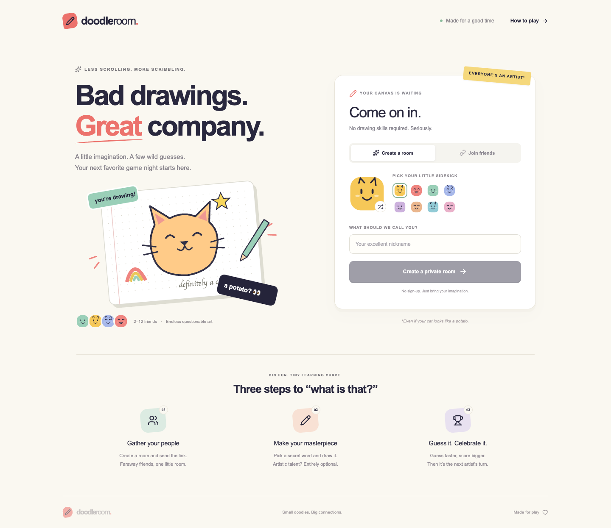

# DoodleRoom

A browser drawing-and-guessing game for 2–12 friends. Built with Next.js, TypeScript, an authoritative Node.js/Socket.IO server, and MongoDB. Original cream-and-ink styling, colorful avatars, and a responsive drawing board.



## Run with one command

With Docker Desktop running, execute from the repository root:

```sh
docker compose up --build
```

Open [localhost:3000](http://localhost:3000), create a room, and open its invitation in separate browsers. No account or cloud credentials are required. MongoDB persists in a named Docker volume; normal container restarts preserve games and drawings.

If port 3000 is occupied:

```sh
PORT=3100 ORIGIN=http://localhost:3100 docker compose up --build
```

## Play

- The host sets rounds, drawing time, and built-in/custom/mixed words, then starts with at least two players.
- The drawer chooses one of three private words. Everyone else guesses against a server-controlled timer, with letter hints and faster-guess bonuses.
- Draw with pen, colors, brush sizes, eraser, fill, undo, and clear. Keyboard shortcuts: **B** pen, **E** eraser, **F** fill, **Ctrl/Cmd+Z** undo.
- Correct answers become success announcements, and successful guessers cannot post spoilers. Near misses receive private “close” feedback.
- Refresh or reconnect within 30 seconds to keep your score and seat. Late joiners see the current canvas, guess next turn, and draw starting next round. Host succession and drawer departure recover automatically.
- At game end, revisit every drawing with pause, seek, playback speed, and PNG download. Completed replays are retained for seven days.

## Deliverables and technical notes

- [Two-minute three-browser recording](artifacts/doodleroom-demo.mp4)
- [Canvas synchronization, authority, ordering, and restart behavior](docs/architecture.md)
- [Measured server capacity](docs/capacity.md) and [reproducible load methodology](docs/load-methodology.md)
- [Local development, deployment, persistence, and operations](docs/operations.md)
- [Private-room Skribbl.io reference study](docs/reference-study.md)
- [Validation evidence and abrupt-crash recovery drill](docs/validation.md)

The recording contains real UI interactions in Chrome, Firefox, and WebKit. Its final WebKit panel holds the completed replay frame for 6.2 seconds to remove a capture glitch; gameplay and the other panels retain their original timing.

## Develop and verify

Use Node.js 24 LTS and pnpm 9.15.9. The [development guide](docs/operations.md#local-development-without-compose) gives independent MongoDB, game-server, and Next.js commands, including ports that avoid the common 3000/4000 defaults.

```sh
pnpm install --frozen-lockfile
pnpm check
pnpm build
```

`pnpm check` runs lint, TypeScript, and unit tests. To include the real MongoDB/Socket.IO integration suite, provide a dedicated test MongoDB endpoint:

```sh
MONGO_TEST_URI=mongodb://127.0.0.1:27018/doodleroom_test pnpm check
```

Against the running app, `pnpm test:e2e` exercises independent Chrome, Firefox, and WebKit sessions plus a mobile layout; `pnpm demo` records the demonstration; `pnpm load --rooms 5 --seconds 600 --output artifacts/load-5.json` runs the capacity harness. See the guides for browser installation, origin settings, and isolated benchmark setup.

The deployment model is one authoritative game-server instance with durable storage. Capacity numbers apply to the measured workload and hardware; this repository does not implement multi-instance room sharding or high availability.
